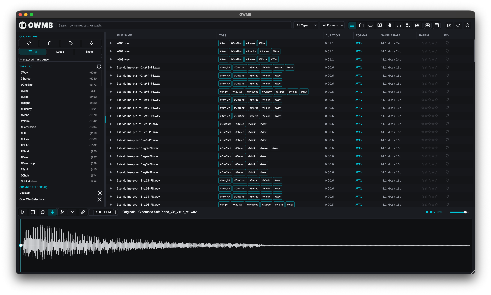
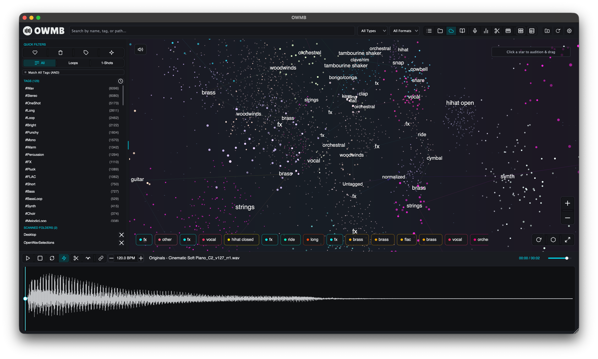
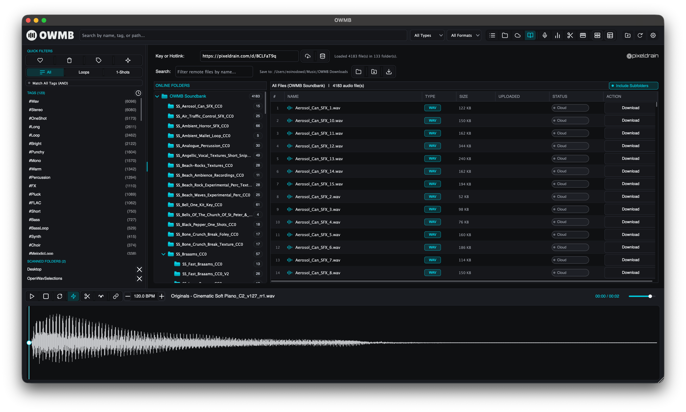
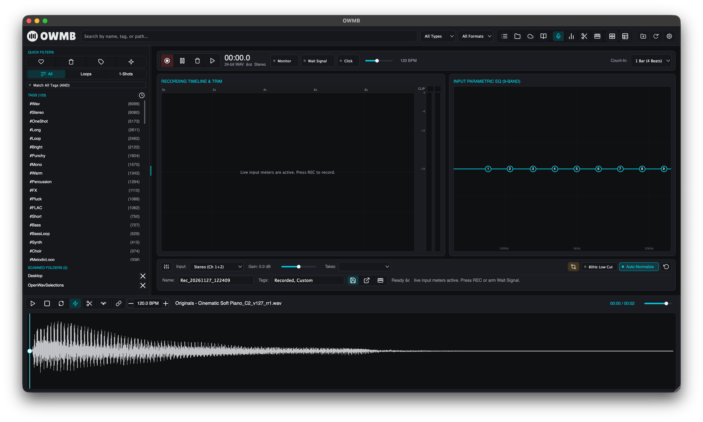
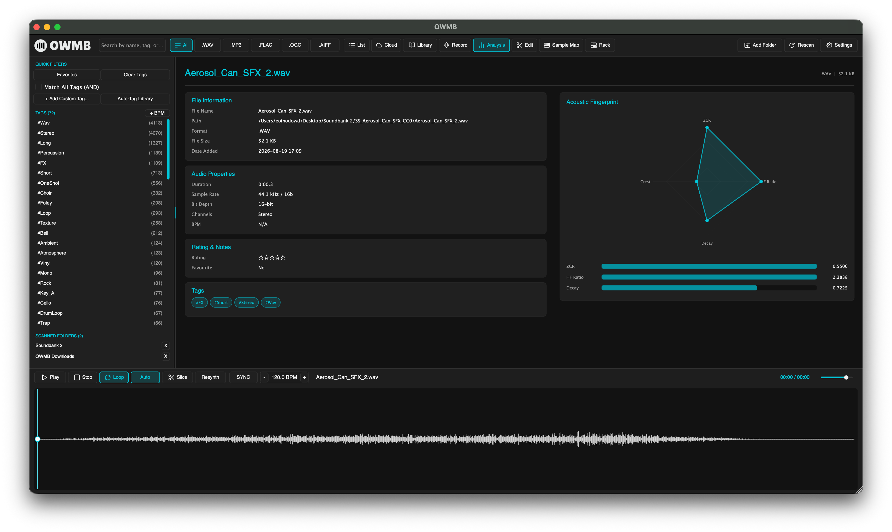
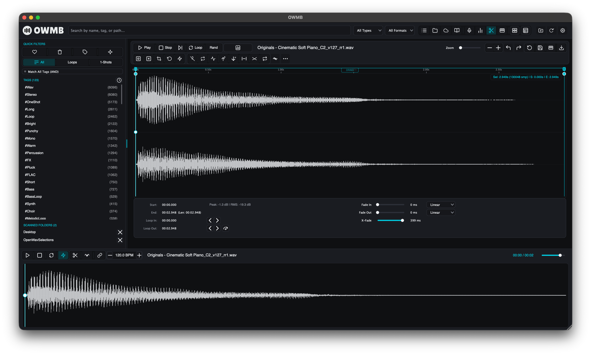
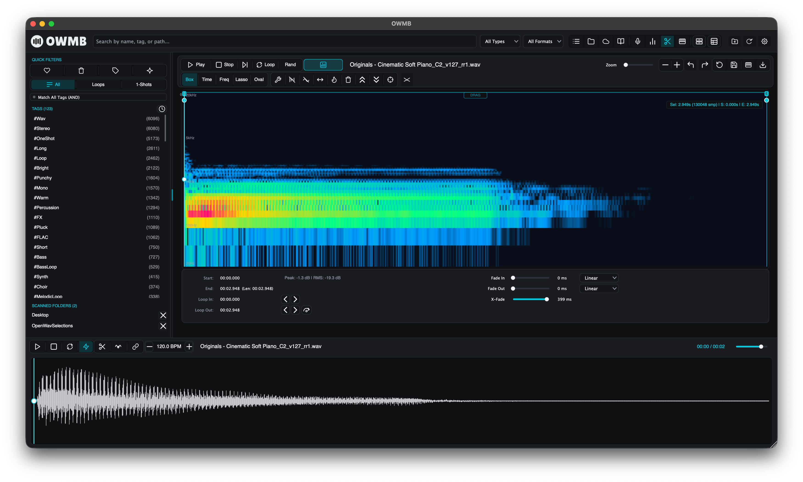
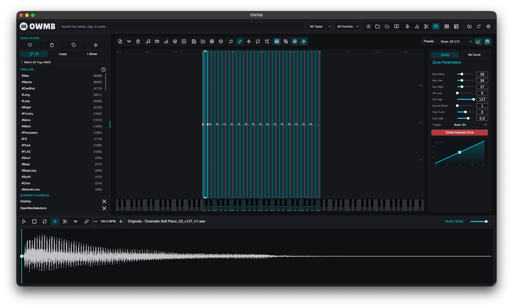
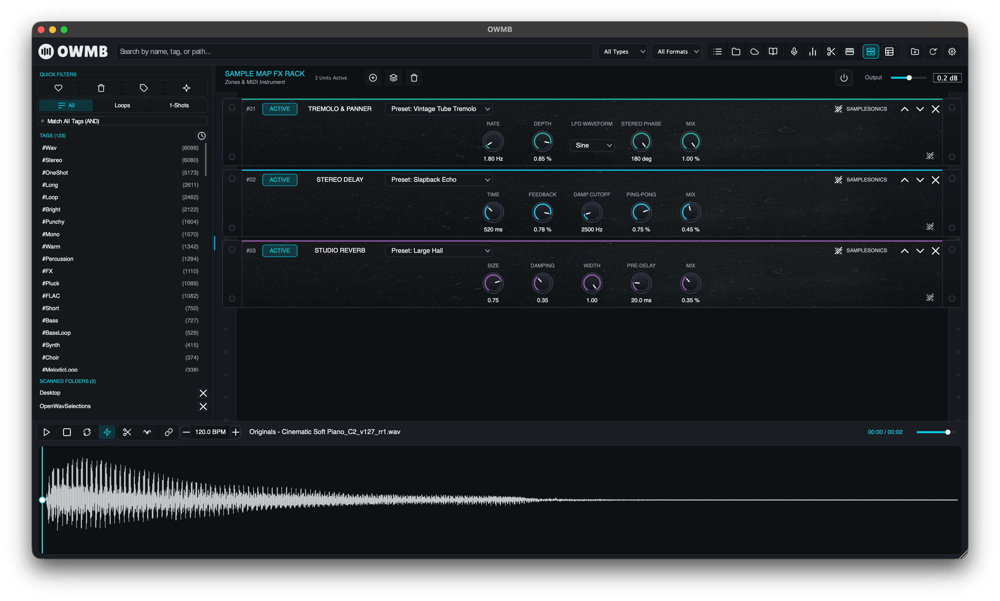

# OWMB - OpenWav Media Browser (Audio Plugin & Standalone App)

**OWMB** (OpenWav Media Browser) is an open-source audio plugin (VST3, AU, and Standalone) for browsing, editing, sampling, and playing sounds. Built with JUCE 8 and C++17, it brings together a fast sample library browser, a 3D sound cloud, a waveform & spectral audio editor, a multi-zone playable sampler with a VST auto-sampler, a 21-effect rack, and a post-production cue sheet in one app.

## Visual Tour & Workspaces

Explore the main views inside OWMB (or press `Cmd/Ctrl + K` anywhere to open the Quick Command Palette):

### 1. List Browser, Folders & Waveform Transport
Browse your samples in a clean list or folder tree with instant search, multi-tag filtering (AND/OR), and format filters (`.WAV`, `.MP3`, `.FLAC`, `.OGG`, `.AIFF`). Preview sounds on the bottom waveform bar with auto-slicing and Loris resynthesis, and drag files straight into your DAW.



### 2. 3D Cloud Visualizer
Explore thousands of samples in a 2D or 3D space grouped by how they sound. Spin and zoom the camera, hover to preview sounds, and launch additive resynthesis.



### 3. Online Cloud Soundbank Library
Browse, preview, and download soundbanks and sample packs from cloud storage directly into your local library.



### 4. Audio Recorder & EQ
Record stereo audio straight into OWMB with live input meters, a count-in metronome, low-cut filter, live oscilloscope, and parametric EQ.



### 5. Sound Analysis
Inspect any sample's acoustic traits with a radar chart showing Zero Crossing Rate, Crest Factor, High-Frequency Energy, and Envelope Decay.



### 6. Waveform & Spectral Audio Editor
Edit samples with multi-step **Undo/Redo** (`Cmd/Ctrl+Z`), Peak dBFS & RMS readouts, zoom/scroll, zero-crossing snapping, fades, **Loop Seam** auditioning, crop/reverse/normalize/trim, and direct **Save to Library** or **Send to Sample Map** buttons. Switch to **Spectral View** to draw, move, or resize Box, Time, Frequency, Lasso, and Oval selections to heal, denoise, de-harmonic, isolate, boost, or remove frequencies.




### 7. Sample Mapper & Instrument Builder
Turn samples into playable instruments (pianos, drum kits, synths, pads) with MIDI input, sustain pedal, and pitch bend support:
- **Key & Velocity Mapping**: Drag, resize, auto-pitch, auto-chromatic map, auto-velocity spread, and set Round Robin (RR) layers on an interactive keybed.
- **Note-Off (Release) Sounds**: Assign samples to trigger when a key is released (like piano key/damper sounds) and filter the grid by **All**, **Note-On Only**, **Release Only**, or **RR Group**.
- **One-Click Instrument Presets**: Quick setups for **Piano**, **Drum Kit**, **Synth Lead / Bass**, and **Lush Pad / Strings**.
- **URL & GitHub Instrument Download**: Download `.zip`, `.sfz`, `.owmap`, `.samplemap`, or `.xml` instruments from any web link, Dropbox, Google Drive, or GitHub repo (`owner/repo`).
- **VST3 / AU Auto-Sampler**: Automatically sample any external VST3/AU plugin across keys, velocities, and round robins—including optional **Note-Off (Release)** capture—and export ready-to-play `.sfz` and Sample Map instruments.



### 8. 21-Effect Modular Rack
Shape your sampler instruments in real time with a reorderable effects rack featuring **21 DSP effects** and presets:
- **Lo-Fi & Creative**: **Live Granulator** (with Freeze mode, grain size, density, pitch, spray, and stereo spread), **Tape Wow & Flutter**, and **Vintage Bitcrusher**.
- **Spatial & Time**: **Shimmer Reverb**, **Studio Reverb**, **Stereo Delay**, **Tape & BBD Flanger**, and **Stereo Width & Imager**.
- **Dynamics & Tone**: **Transient Shaper**, **Global ADSR Envelope**, **VCA Compressor**, **3-Band Parametric EQ**, **Multi-Mode SVF Filter**, **Analog Saturation**, **Dynamic Auto-Wah**, and **Amp & Cabinet Simulator**.
- **Modulation & Pitch**: **Stereo Chorus**, **Analog Phaser**, **Pitch Harmonizer**, **Tremolo & Auto-Panner**, and **Metallic Ring Modulator**.



### 9. Cue Sheet (Used Samples Spreadsheet)
Keep track of every sample and trimmed region used in your project for post-production documentation. Automatically logs samples sent to the Sample Map, auto-sliced, or saved from the Editor; lets you edit **Scene / Track** and **Notes** inline, audition cues, and export a **CSV** spreadsheet.

---

## Key Features

- **Fast Sample Browser & Tagging**: Multi-threaded library scanner, instant search, tag cloud, and Boolean (AND/OR) tag filtering.
- **Quick Command Palette (`Cmd/Ctrl + K`)**: Jump to any view, run actions, or search and load samples from anywhere in the app.
- **3D & 2D Sound Cloud**: Explore your library visually by sound similarity with real-time additive resynthesis.
- **Waveform & Spectral Editor**: Non-destructive editing with multi-step Undo/Redo, Peak/RMS meters, Loop Seam preview, and spectral repair/denoise/gain tools.
- **Playable Multi-Zone Sampler & Auto-Sampler**: Supports Note-On & Note-Off (Release) triggers, Round Robins, velocity curves, sustain pedal, pitch bend, SFZ/ZIP import, URL/GitHub downloads, and offline VST3/AU auto-sampling.
- **21-Effect Performance Rack**: Real-time Live Granulator, Shimmer Reverb, Tape Wow & Flutter, Transient Shaper, EQ, Compression, Delays, and Modulation.
- **Post-Production Cue Sheet**: Spreadsheet log of all used samples and time regions with CSV export.
- **DAW Drag-and-Drop**: Drag samples or edited selections straight into Ableton Live, FL Studio, Logic Pro, Reaper, Cubase, or Bitwig (on macOS, hold `Control` while dragging if needed).
- **Cross-Platform**: Runs on Windows 11, macOS (Apple Silicon & Intel), and Linux.

## Keyboard Shortcuts

| Key | Action |
| :--- | :--- |
| `Cmd/Ctrl + K` | Open Quick Command Palette |
| `Space` | Play / Pause |
| `Shift + Space` | Play Selection (in Editor) |
| `Cmd/Ctrl + Z` | Undo Edit (in Editor) |
| `Cmd/Ctrl + Shift + Z` | Redo Edit (in Editor) |
| `Z` / `N` / `R` / `C` | Snap 0-X / Normalize / Reverse / Crop (in Editor) |
| `+` / `-` | Zoom In / Zoom Out |
| `Delete` / `Backspace` | Silence Selection (Editor) or Remove Selected Zone/Cue |
| `Escape` | Close Dialogs / Deselect |

---

## Download & Releases

Pre-built binaries and installers for **Windows 11**, **macOS** (Universal for Apple Silicon & Intel), and **Linux Distros** are available under [GitHub Releases](https://github.com/samplaman/owmb/releases).

- **Microsoft Store / Standalone (.exe)**: `OWMB-MicrosoftStore-Standalone.exe` (Unzipped Direct Executable)
- **Windows Installer (.exe)**: `OWMB-MicrosoftStore-Installer.exe` / `OWMB-Installer.exe` (Unzipped Setup Installer)
- **Windows 11 Bundle (.zip)**: `OWMB-Windows-11-x64.zip` (VST3 Plugin & Standalone `.exe`)
- **macOS Universal Installer (.pkg / .dmg)**: `OWMB-macOS-Universal-Installer.pkg` / `OWMB-macOS-Universal-Installer.dmg` / `OWMB-macOS-Universal.dmg` (VST3, AU & App for Apple Silicon & Intel)
- **Linux Distros (.tar.gz)**: `OWMB-Linux-Distros-x64.tar.gz` (VST3 Plugin & Standalone Executable)

> [!TIP]
> **macOS Installation & Gatekeeper**:
> - **Native Package Installer (`.pkg`)**: Run `OWMB-macOS-Universal-Installer.pkg` to install the standalone application (`/Applications`), VST3 (`/Library/Audio/Plug-Ins/VST3`), and AU Component (`/Library/Audio/Plug-Ins/Components`).
> - **Disk Image Installer (`.dmg`)**: You can also open `OWMB-macOS-Universal-Installer.dmg` and drag the app and plugins into the folder shortcuts.
> - If macOS Gatekeeper displays an "unidentified developer" prompt, Control-click (or right-click) the `.pkg` and select **Open**, or navigate to **System Settings > Privacy & Security** and click **Open Anyway**.

---

## Building OWMB Locally

### Requirements
- **CMake** 3.22 or higher
- C++17 compatible compiler (Visual Studio 2022 / MSVC, Clang, or GCC)
- **Git** (for automatically fetching JUCE 8 via CMake `FetchContent`)

### Build Steps

#### macOS (Universal: Apple Silicon & Intel)
```bash
# Clone the repository
git clone https://github.com/samplaman/owmb.git
cd owmb

# Option A: Use the macOS build helper script
./build-macos.sh

# Option B: Manual CMake configuration
cmake -B build -DCMAKE_BUILD_TYPE=Release \
  -DCMAKE_OSX_ARCHITECTURES="arm64;x86_64" \
  -DCMAKE_OSX_DEPLOYMENT_TARGET="10.15"
cmake --build build --config Release -j 4
```

#### Windows & Linux
```bash
# Configure build directory with CMake
cmake -B build -DCMAKE_BUILD_TYPE=Release

# Compile VST3 & Standalone targets
cmake --build build --config Release -j 4
```

The compiled binaries will be output in:
- **VST3 Plugin**: `build/OpenWav_artefacts/Release/VST3/OWMB.vst3`
- **AU Plugin (macOS)**: `build/OpenWav_artefacts/Release/AU/OWMB.component`
- **Standalone App**: `build/OpenWav_artefacts/Release/Standalone/OWMB.app` (macOS) or `OWMB.exe` (Windows)

### macOS Code Signing & Notarization
See [docs/MACOS_CODESIGNING_GUIDE.md](docs/MACOS_CODESIGNING_GUIDE.md) for full instructions on signing and notarizing with your Apple Developer Account (Developer ID Application).

---

## Architecture & Project Structure

```
owmb/
├── CMakeLists.txt              # CMake build configuration (JUCE 8 FetchContent)
├── .github/workflows/          # Automated GitHub Actions CI/CD release workflow
│   └── release.yml             # Windows 11 & Linux matrix release builder
├── docs/                       # Project documentation & preview screenshots
│   ├── MACOS_CODESIGNING_GUIDE.md
│   └── screenshots/            # High-resolution screenshots of all 9 workspaces
│       ├── 01-list-browser.png
│       ├── 02-3d-cloud.png
│       ├── 03-online-library.png
│       ├── 04-recorder-eq.png
│       ├── 05-acoustic-analysis.png
│       ├── 06-waveform-editor.png
│       ├── 07-spectral-editor.png
│       ├── 08-sample-map.png
│       └── 09-effects-rack.png
└── Source/
    ├── Audio/                  # Asynchronous disk read-ahead sample transport engine
    │   ├── AudioEngine.h / .cpp
    │   └── EffectsRackEngine.h / .cpp        # 16-DSP studio rack effects processor
    ├── Database/               # Persistent JSON metadata library index & tag manager
    │   ├── TagDatabaseManager.h / .cpp
    │   └── PixeldrainClient.h / .cpp
    ├── Models/                 # MediaItem & SampleMap data structures & serialization
    │   ├── MediaItem.h
    │   └── SampleMap.h
    ├── Scanner/                # Multi-threaded fast RIFF/WAVE header reader scanner
    │   ├── LibraryScanner.h / .cpp
    │   └── AcousticAnalyzer.h / .cpp
    └── UI/                     # JUCE LookAndFeel & GUI components
        ├── HeaderBarComponent.h / .cpp       # Top control bar, search, & view switcher
        ├── TagPanelComponent.h / .cpp        # Sidebar tag cloud & scanned folders manager
        ├── SampleTableComponent.h / .cpp     # Multi-column sample list table view
        ├── SampleCloudComponent.h / .cpp     # 3D interactive sample constellation visualizer
        ├── WaveformTransportComponent.h / .cpp # Audio waveform player & playhead transport
        ├── AudioRecorderComponent.h / .cpp   # Audio recorder with parametric EQ
        ├── AcousticAnalysisComponent.h / .cpp # Timbral radar chart & spectral analysis
        ├── WaveformEditorComponent.h / .cpp  # Waveform editor, transient slicer & fades
        ├── SpectralEditorComponent.h / .cpp  # High-resolution spectrogram spectral editor
        ├── SampleMapComponent.h / .cpp       # Multi-velocity sample mapper with keybed
        ├── EffectsRackComponent.h / .cpp     # 16-DSP modular effects rack
        └── OpenWavLookAndFeel.h / .cpp       # Pro-audio dark LookAndFeel design system
```

---

## License

Copyright (c) 2026 OWMB Developer. Open-source under MIT / JUCE 8 License terms.
